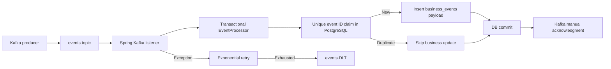

# Spring Kafka Reliable Processing

Java 17 / Spring Boot 3.3 reference implementation for reliable **at-least-once** Kafka event consumption with PostgreSQL idempotency, manual acknowledgments, bounded retries and dead-letter routing.

## Architecture



The event **key** is the idempotency ID. The PostgreSQL primary key and `INSERT ... ON CONFLICT DO NOTHING` prevent duplicate business writes across consumer instances and restarts. The claim and business insert run in one Spring database transaction. A failed business insert rolls back the claim, so redelivery can retry.

Kafka offset commits and PostgreSQL transactions are **not atomic**: a crash after database commit but before offset acknowledgment can redeliver the event. The unique claim makes the database effect idempotent; it does not promise exactly-once Kafka delivery.

## Requirements and run

- Java 17 and Maven.
- PostgreSQL 16-compatible database and Apache Kafka broker.
- Docker engine for Testcontainers integration tests.
- Provision `events` and `events.DLT` topics. The DLT must have at least as many partitions as the source topic because recovery retains the original partition.

Environment variables (defaults shown for local development):

| Variable | Default | Purpose |
|---|---|---|
| `DB_URL` | `jdbc:postgresql://localhost:5432/events` | JDBC connection |
| `DB_USER` | `events` | Database user |
| `DB_PASSWORD` | `events` | Local-only example password; replace outside local development |
| `KAFKA_BOOTSTRAP_SERVERS` | `localhost:9092` | Kafka bootstrap broker |

```bash
mvn -B clean verify
mvn spring-boot:run
```

Flyway applies `V1__processed_events.sql` and `V2__business_events.sql` at application startup. Spring Data JPA uses `ddl-auto: validate`, not schema creation. The example stores the original event payload in `business_events`; substitute domain-specific validation and business operations for a real application.

Example producer command (requires Kafka CLI and existing topic):

```bash
printf 'order-123:{"orderId":123}\n' | kafka-console-producer.sh --bootstrap-server localhost:9092 --topic events --property parse.key=true --property key.separator=:
```

## Failure handling

The listener acknowledges after `EventProcessor.process()` returns and the database transaction has completed. Exceptions propagate to Spring Kafka's `DefaultErrorHandler`. It uses exponential backoff (initial 1 second, multiplier 2, capped at 8 seconds, 15 seconds total elapsed) and a `DeadLetterPublishingRecoverer` that routes to `<original-topic>.DLT` on the same partition. Producer key and value serializers are explicitly configured as strings.

DLT events need operational monitoring, retention policy, root-cause triage and a deliberate replay process. A failed DLT publish must not be treated as successful recovery. This example does not provide an administrative replay service.

## Verification

- `EventProcessorTest`: claim/write ordering, duplicate skipping and input validation.
- `EventProcessorPostgresIntegrationTest`: real PostgreSQL persistence and duplicate protection.
- `ReliableEventListenerTest`: acknowledgment ordering and failure behavior.
- `KafkaErrorHandlingConfigTest`: error-handler construction.
- `KafkaProcessingIntegrationTest`: Testcontainers Kafka/PostgreSQL broker delivery, duplicate redelivery, and invalid-event dead-letter recovery.
- GitHub Actions runs `mvn -B verify` on pushes and pull requests.

**Scope:** This is a reference application, not a production deployment blueprint. Production work may require TLS/SASL, secrets management, observability, schema contracts, authorization, poison-message alerting, DLT replay, retention policy and operational load testing. `IdempotencyGate` is an isolated in-memory educational example; the listener uses the durable PostgreSQL mechanism instead.


## Step-by-step local quickstart (Windows PowerShell, macOS, or Linux)

**Prerequisites:** JDK 17, Maven 3.9+, Git, Docker Desktop/Engine with Linux containers, free TCP ports **5432** and **9092**, internet access to download Maven dependencies and container images. Confirm `java -version`, `mvn -version`, `git --version` and `docker info` work. Docker must be **running**, not merely installed. Allow sufficient Docker memory for Kafka and PostgreSQL.

1. Clone and enter the project:
   ```bash
   git clone https://github.com/rocky-bgta/spring-kafka-reliable-processing.git
   cd spring-kafka-reliable-processing
   ```
2. Start the local dependencies (the credentials below are **development only**):
   ```bash
   docker run -d --name reliable-postgres -e POSTGRES_DB=events -e POSTGRES_USER=events -e POSTGRES_PASSWORD=events -p 5432:5432 postgres:16-alpine
   docker run -d --name reliable-kafka -p 9092:9092 apache/kafka:3.8.1
   ```
   Wait for both containers to initialize; check `docker ps` and `docker logs reliable-kafka`. The Apache Kafka image starts a single-node development broker with its default configuration; use the Testcontainers test for a self-contained verification if your local Kafka networking differs.
3. Create the source and dead-letter topics (one partition each):
   ```bash
   docker exec reliable-kafka /opt/kafka/bin/kafka-topics.sh --bootstrap-server localhost:9092 --create --if-not-exists --topic events --partitions 1 --replication-factor 1
   docker exec reliable-kafka /opt/kafka/bin/kafka-topics.sh --bootstrap-server localhost:9092 --create --if-not-exists --topic events.DLT --partitions 1 --replication-factor 1
   ```
4. Run all automated tests **with Docker running**. Testcontainers starts its **own isolated** Kafka and PostgreSQL containers; these tests do not require the manual containers from step 2:
   ```bash
   mvn -B clean verify
   ```
   Expected: Maven reports `BUILD SUCCESS` and tests finish without failures. Docker access is mandatory for the integration tests.
5. Start the application (keep this terminal open):
   ```bash
   mvn spring-boot:run
   ```
   Default connection values in `application.yml` match the development containers. Flyway creates the tables on startup. Wait for Spring Boot startup without connection errors. This is a **Kafka consumer, not an HTTP API**; there is no browser endpoint to open.
6. In another terminal, send an event:
   ```bash
   docker exec reliable-kafka /opt/kafka/bin/kafka-console-producer.sh --bootstrap-server localhost:9092 --topic events --property parse.key=true --property key.separator=:
   ```
   Type `order-123:{"orderId":123}` and press Enter, then stop the producer with Ctrl+C. The text before the colon is the Kafka message key and durable idempotency ID.
7. Verify PostgreSQL persistence:
   ```bash
   docker exec reliable-postgres psql -U events -d events -c "SELECT event_id, payload FROM business_events;"
   docker exec reliable-postgres psql -U events -d events -c "SELECT event_id FROM processed_events;"
   ```
   Expected: one row for `order-123`. Send the same key with a different payload and query again: the original payload should remain and there should still be one row for that event ID.
8. Optional failure-path check: send a message with an **empty key** (enter `:invalid-payload` in the same producer). After configured retries, inspect the DLT:
   ```bash
   docker exec reliable-kafka /opt/kafka/bin/kafka-console-consumer.sh --bootstrap-server localhost:9092 --topic events.DLT --from-beginning --timeout-ms 30000
   ```
   Expected: `invalid-payload` appears. The DLT is for inspection; this sample has no replay service.

**Stop and clean up:** stop Spring Boot with Ctrl+C, then run `docker rm -f reliable-kafka reliable-postgres` to remove the disposable development containers **and their stored data**. If port 5432/9092 is already in use, stop the conflicting service or adjust the port mapping **and** application connection settings. Set `DB_URL`, `DB_USER`, `DB_PASSWORD` and `KAFKA_BOOTSTRAP_SERVERS` for non-default hosts. For CI, inspect the GitHub Actions tab; the same Maven `verify` command runs there.
