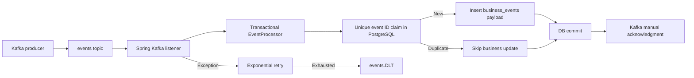

# Spring Kafka Reliable Processing

Java 17 / Spring Boot 3.3 reference implementation for reliable **at-least-once** Kafka event consumption with PostgreSQL idempotency, manual acknowledgments, bounded retries and dead-letter routing.

## Architecture



The event **key** is the idempotency ID. The PostgreSQL primary key and `INSERT ... ON CONFLICT DO NOTHING` prevent duplicate business writes across consumer instances and restarts. The claim and business insert run in one Spring database transaction. A failed business insert rolls back the claim, so redelivery can retry.

Kafka offset commits and PostgreSQL transactions are **not atomic**: a crash after database commit but before offset acknowledgment can redeliver the event. The unique claim makes the database effect idempotent; it does not promise exactly-once Kafka delivery.

## Requirements and run

- Java 17 and Maven.
- PostgreSQL 16-compatible database and Apache Kafka broker.
- Docker engine for Testcontainers integration tests.
- Provision `events` and `events.DLT` topics. The DLT must have at least as many partitions as the source topic because recovery retains the original partition.

Environment variables (defaults shown for local development):

| Variable | Default | Purpose |
|---|---|---|
| `DB_URL` | `jdbc:postgresql://localhost:5432/events` | JDBC connection |
| `DB_USER` | `events` | Database user |
| `DB_PASSWORD` | `events` | Local-only example password; replace outside local development |
| `KAFKA_BOOTSTRAP_SERVERS` | `localhost:9092` | Kafka bootstrap broker |

```bash
mvn -B clean verify
mvn spring-boot:run
```

Flyway applies `V1__processed_events.sql` and `V2__business_events.sql` at application startup. Spring Data JPA uses `ddl-auto: validate`, not schema creation. The example stores the original event payload in `business_events`; substitute domain-specific validation and business operations for a real application.

Example producer command (requires Kafka CLI and existing topic):

```bash
printf 'order-123:{"orderId":123}\n' | kafka-console-producer.sh --bootstrap-server localhost:9092 --topic events --property parse.key=true --property key.separator=:
```

## Failure handling

The listener acknowledges after `EventProcessor.process()` returns and the database transaction has completed. Exceptions propagate to Spring Kafka's `DefaultErrorHandler`. It uses exponential backoff (initial 1 second, multiplier 2, capped at 8 seconds, 15 seconds total elapsed) and a `DeadLetterPublishingRecoverer` that routes to `<original-topic>.DLT` on the same partition. Producer key and value serializers are explicitly configured as strings.

DLT events need operational monitoring, retention policy, root-cause triage and a deliberate replay process. A failed DLT publish must not be treated as successful recovery. This example does not provide an administrative replay service.

## Verification

- `EventProcessorTest`: claim/write ordering, duplicate skipping and input validation.
- `EventProcessorPostgresIntegrationTest`: real PostgreSQL persistence and duplicate protection.
- `ReliableEventListenerTest`: acknowledgment ordering and failure behavior.
- `KafkaErrorHandlingConfigTest`: error-handler construction.
- `KafkaProcessingIntegrationTest`: Testcontainers Kafka/PostgreSQL broker delivery, duplicate redelivery, and invalid-event dead-letter recovery.
- GitHub Actions runs `mvn -B verify` on pushes and pull requests.

**Scope:** This is a reference application, not a production deployment blueprint. Production work may require TLS/SASL, secrets management, observability, schema contracts, authorization, poison-message alerting, DLT replay, retention policy and operational load testing. `IdempotencyGate` is an isolated in-memory educational example; the listener uses the durable PostgreSQL mechanism instead.
