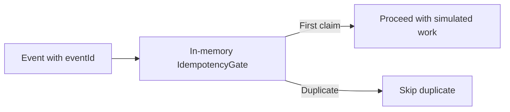
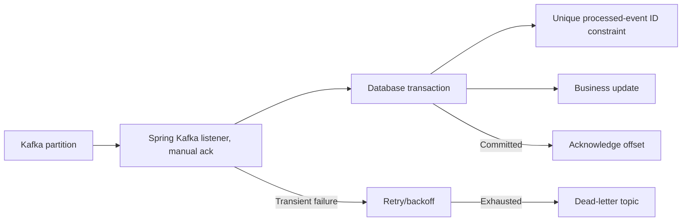

# Spring Kafka Reliable Processing

Incremental Java 17 project focused on correctness under duplicate event delivery.

## Run current tests

```bash
mvn clean verify
```

## Implemented

- `IdempotencyGate` uses `ConcurrentHashMap.newKeySet()` to atomically claim event IDs within one JVM.
- JUnit 5 checks duplicates, blank IDs and concurrent claims.
- GitHub Actions runs Maven verification.

## Current demonstration flow



**Not production-safe yet:** The in-memory set is lost on restart and cannot coordinate multiple instances. It also marks an event claimed before business work succeeds. Do **not** acknowledge a Kafka offset based on this gate alone.

## Target production architecture (not implemented)



Database changes and the deduplication record must commit atomically; commit the Kafka offset only after successful DB commit. A crash after DB commit but before offset commit may redeliver the event, so database idempotency remains necessary. Offset commits and database commits are not one atomic transaction by default.

## Next implementation milestones

- Spring Boot listener, manual ack configuration and explicit consumer settings.
- PostgreSQL unique key and transactional business update.
- Kafka/Postgres Testcontainers integration tests, retries and DLT.
